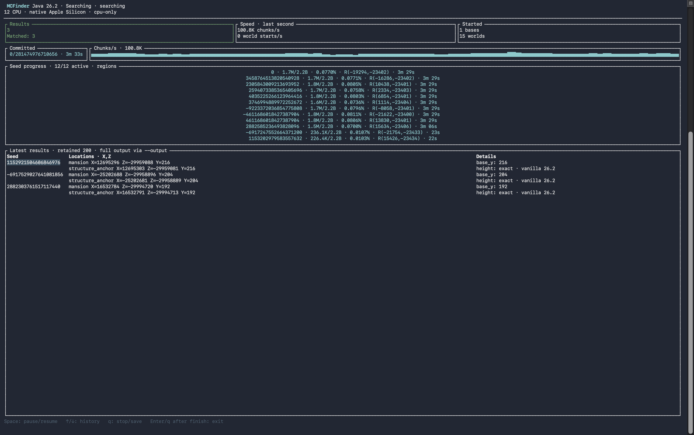
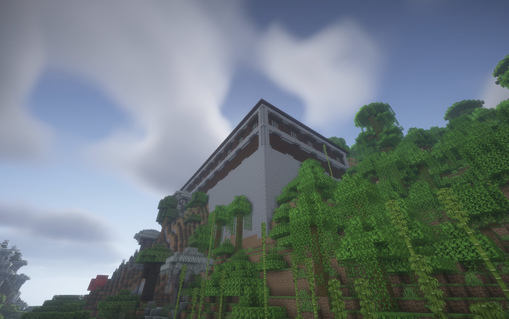

<div align="center">

# MCFinder

### Find the exception. Let the engine do the searching.

**[English](README.md) · [Русский](README.ru.md)**

[](https://github.com/D1ma-coder/MCFinder/actions/workflows/ci.yml)
[](https://github.com/D1ma-coder/MCFinder/releases/latest)
[](LICENSE)
[](Cargo.toml)

[Download](https://github.com/D1ma-coder/MCFinder/releases/latest) · [Handbook](docs/GUIDE.md) · [Benchmarks](benchmarks/README.md) · [Examples](examples/scripts)


</div>

A **Rust engine for Minecraft Java seed candidate searches**. Describe the world you want in a script; MCFinder owns the seed loop, CPU workers, optional GPU filtering, progress events, checkpoints, and results.

Find a shipwreck next to a mansion. Search for a village with useful structures around spawn. Explore mansions on unusually high estimated terrain. Use the same engine in a terminal, desktop app, service, or your own Rust project.

> Structure positions and biomes are checked; full blocks, loot and structure footprints are not generated. Terrain height and spawn are estimates. Profiles from **1.21.5 through 26.3 are experimental**. Results are candidates to verify in the selected game version.

## See it working



*Actual search results: 10 CPU workers on Apple M2 Pro, three candidates with estimated base Y ≥170. Coordinates and estimated height are separate; this is not a generated block-height measurement.*



*A woodland mansion found with MCFinder and inspected in-game, with a towering foundation. **Java 26.2 · seed `4743858` · X=`1792`, Z=`-2416`**. Engine estimate: base Y≈172.4; actual foundation height was not measured by the engine.*

## Why build on MCFinder?

| Capability | What you get |
|---|---|
| Scriptable predicates | Rhai `configure()` + `matches()`; compile once, evaluate only surviving candidates |
| Native search planner | Structure spacing, rarity-aware pair direction, adjacent-region checks, cheaper rules before spawn |
| CPU + GPU | CPU-only or OpenCL placement prefilter plus CPU validation; CPU thread count in both modes |
| Automatic hardware profiles | Native C CPU builds; Apple, NVIDIA and generic integer GPU paths selected by device vendor |
| 48-bit geometry reuse | Filter low-48-bit structure seeds once, then expand upper bits for biome checks |
| Live TUI | One-second metrics, K/M/B/T counters, readable elapsed time, coordinates, pause and resume |
| Backend protocol | Persistent JSONL process with start, status, pause, resume, cancel, restore and shutdown |
| Long-running jobs | Adaptive batches, bounded result buffers, checkpoints and range sharding |
| Rust SDK | Native predicates and custom world-data providers with cooperative cancellation |
| Exact seed transport | Seeds and counters use decimal strings across JSON to preserve all 64 bits |

### Fast because it avoids expensive work early

```text
seed range -> placement geometry -> optional GPU rejection
           -> CPU biome/spawn validation -> compiled script -> result
```

The planner checks the rarer structure first and probes nearby regions for its partner. Biome evaluation comes after cheap geometry. Expanding a structure seed reuses its placements instead of recomputing them for every upper-bit variant. Dedicated terrain helpers run their loops natively and reject a low mansion as soon as one placement probe fails the height estimate.

The C core keeps wrapping integer semantics and avoids fast-math. GPU paths implement Java-compatible integer placement arithmetic; they do not approximate biome checks. The engine reports its actual build/device profile rather than asking you to guess a vendor preset.

**No universal speed multiplier:** arbitrary scripts stay on CPU, GPU is not always faster, and initializing the biome generator still prepares more noise data than some predicates need. Independent native rules can select different structures; use a script to enforce relationships around the same village or mansion. See [optimization and limits](docs/GUIDE.md#performance-and-accuracy).

## Measured performance

The committed [benchmark report](benchmarks/README.md) includes commands, hardware, sample count, medians, ranges, raw timings and deterministic output hashes. Measurements are on **Apple M2 Pro**, with the actual thread count recorded per scenario.

A measured earlier fixed-range comparison searched the same 100,000 seeds with 10 threads:

| High-mansion filter, estimated Y ≥150 | Throughput | Time |
|---|---:|---:|
| Rhai region loop | 13,833 seeds/s | 7.229 s |
| Native loop + early height rejection | 45,872 seeds/s | 2.180 s |

**3.32× faster with identical five result payloads.** This is a measured improvement to that predicate, not a claim about every search. The reproducible suite also measures pure geometry, biome validation, upper-bit expansion, GPU filtering and slime chunks. No physical NVIDIA or Windows throughput figures are claimed.

## Quick start

Download the archive matching your machine from [Releases](https://github.com/D1ma-coder/MCFinder/releases/latest), extract it, and open a terminal in the extracted folder:

```sh
./mcfinder devices
./mcfinder search --script examples/scripts/high-mansion.rhai \
  --experimental --mode cpu-only --cores 8 --ui tui \
  --count 1000000000 --max-results 3 \
  --output mansions.jsonl --checkpoint mansions.checkpoint.json
```

On Windows use `.\mcfinder.exe` instead of `./mcfinder`; enter the command on one line in PowerShell. The release includes examples and documentation. Binaries are unsigned; macOS builds are not notarized. CPU-only needs no OpenCL runtime; GPU mode needs a compatible driver (macOS uses its system OpenCL framework).

**TUI keys:** Space pauses/resumes; ↑/↓ browses retained results; q/Esc/Ctrl+C stops and saves. A finished run stays visible until Enter/q. Repeat a stopped job with:

```sh
./mcfinder resume mansions.checkpoint.json --cores 8 --ui tui
```

The three builds target **Windows x64**, **macOS Apple Silicon**, and **macOS Intel**. Distributed CPU binaries use portable settings, not the CI runner's native instruction set. For maximum tuning on your own chip, build locally.

## Write a search in a few lines

```rust
// examples/scripts/high-mansion.rhai — estimated terrain, not full world generation
fn configure() { #{version: "26.2", radius: 5120, rules: []} }
fn matches(world, candidate) {
    let result = world.high_mansion(170.0, 4);
    if result == () { return false; }
    result
}
```

`high_mansion()` scans an 8×8 region grid with native loops and returns a biome-valid candidate, estimated base height, and coordinates. Script-only terrain searches use CPU-only. For a GPU-supported placement query:

```sh
./mcfinder search --version 1.18.2 --near mansion:village:10 \
  --radius 4096 --mode cpu-and-gpu --cores 8 \
  --structure-seeds --upper-count 256 --count 1000000 \
  --max-results 3 --output pairs.jsonl
```

Distances refer to structure **start positions in X/Z**. Each structure has to be within the configured search square. See [all examples](examples/scripts) and the [script API](docs/GUIDE.md#script-api).

## Embed it in your project

**Any language:** launch `mcfinder serve`, send one JSON command per stdin line and continuously drain stdout events. No HTTP server, port or SDK dependency is required.

```json
{"cmd":"start","id":"job-1","max_results":3,"settings":{"query":{"version":"1.18.2","radius":4096,"rules":[{"type":"near","a":"mansion","b":"village","distance":10}]},"mode":"cpu-only","cores":4,"count":"1000000"}}
{"cmd":"status","id":"status-1"}
{"cmd":"pause","id":"pause-1"}
{"cmd":"resume","id":"resume-1"}
```

Events include `started`, `ready`, `progress`, `match`, `error`, and `finished`. Progress arrives from an independent one-second reporting thread, even during a slow evaluation or a pause. Consumers must read the stream continuously; a blocked pipe creates backpressure.

- **Python / desktop / services:** [working standard-library client](examples/backend_client.py).
- **Node.js / web backends:** subprocess integration and safe seed transport in the [handbook](docs/GUIDE.md#backend-integration).
- **Rust:** [SDK example](examples/sdk.rs), [custom Rhai function and backend host](examples/sdk_script.rs). Use a Git dependency pinned to a release tag; the crate is not published to crates.io.
- **Custom data:** provide block, loot or other world-generation logic via `SeedFilter` / `ScriptExtension`. Those capabilities are extension points, not built-in guarantees.

Checkpoints keep the resolved query, script source and required provider identities. Recovery is **at least once**: deduplicate by `seed_bits`. One backend process runs one active job; use multiple processes and sharding to scale across machines.

## Build and test

Install stable Rust and a C compiler (Xcode Command Line Tools on macOS; MSVC C++ Build Tools on Windows; GCC/Clang on Linux).

```sh
git clone https://github.com/D1ma-coder/MCFinder.git
cd MCFinder
cargo build --release --locked
cargo test --locked
cargo clippy --locked --all-targets -- -D warnings
```

Cubiomes and the community patches are vendored. Cargo dependencies still need downloading on the first build. Default builds tune C for the build host; cross-compilation and `--no-default-features` use portable C settings.

```sh
# macOS/Linux: tune both Rust and C for your current CPU
./scripts/build-native.sh
# Portable build for distribution
cargo build --release --locked --no-default-features
```

[Release workflow](.github/workflows/release.yml) builds and tests on Windows and both macOS architectures, bundles notices/examples/docs, and publishes SHA-256 checksums. CI tests Linux too. GPU hardware tests are optional and are not replaced by CPU-only CI.

## Documentation map

| Read this | For |
|---|---|
| [Handbook](docs/GUIDE.md) / [Руководство](docs/GUIDE.ru.md) | TUI, CLI, scripting, backend commands, SDK, recovery and troubleshooting |
| [Engine reference, Russian](docs/ENGINE.md) | Detailed JSONL schema, counters, extension contracts and resource limits |
| [CLI reference, Russian](docs/REFERENCE.ru.md) | Version profiles, placement rules, sharding and exact CLI behavior |
| [Benchmarks](benchmarks/README.md) | Reproduce and interpret performance measurements |
| [Changelog](CHANGELOG.md) | Release changes |

## Star History

If MCFinder helps you find something unusual, a star helps others discover it.

[](https://www.star-history.com/#D1ma-coder/MCFinder&Date)

*The chart becomes useful as the repository accumulates stars; it is not a performance metric.*

## Credits and license

MIT. Built with [Cubiomes](https://github.com/Cubitect/cubiomes), vendored community version patches ([provenance](vendor/README.md)), Rust, Rhai, Rayon, Ratatui and Crossterm. Dependency notices are included in release archives. Minecraft is a trademark of Mojang/Microsoft; MCFinder is an independent project and is not affiliated with them.
